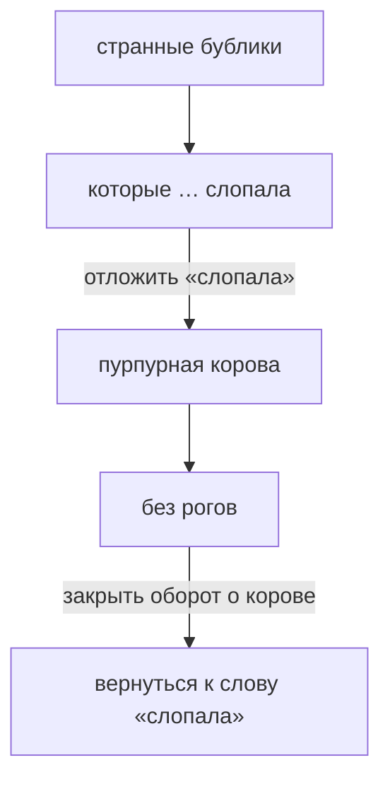

## Что такое рекурсия

В [[dialogue-05-little-harmonic-labyrinth|«Маленьком гармоническом лабиринте»]] Ахилл и Черепаха начинают читать рассказ о самих себе. Внутри рассказа они находят ещё одну книгу. Чтобы продолжить прерванную историю, надо помнить, где они остановились.

У главы два входа: [через сюжет и язык](#сюжет-и-язык) и [через числа](#рекурсия-в-теории-чисел). В обоих пригодится вопрос: **к какой меньшей задаче мы переходим и где можно остановиться?**

Представьте, что нужно посчитать книги в коробке, в которой лежат и книги, и другие коробки. Посчитайте книги, лежащие прямо в ней. Затем примените то же правило к каждой вложенной коробке и прибавьте её итог. Как только внутри больше нет коробок, можно просто посчитать книги. Хофштадтер называет это **«дном»**. Для числовых рядов ниже таким дном становятся заранее заданные первые значения.

В [[chapter-03-figure-and-ground|главе III]] слова «рекурсивное» и «рекурсивно перечислимое» описывают свойства множеств. Здесь в центре внимания устройство **процедуры**: как она открывает подзадачу, где останавливается и как использует ответ. [[recursion|Карточка «Рекурсивность»]]

## Сюжет и язык

### Стек закладок

При входе во вложенный рассказ положим закладку в том месте, где прервали чтение. Если откроем ещё один рассказ, новая закладка ляжет сверху. При возврате берём верхнюю. Такая стопка называется **стеком**: запись, добавленную последней, снимают первой. Вход с сохранением места — [[pushing-tonic|проталкивание, push]], возврат с восстановлением места — [[popping-tonic|выталкивание, pop]].


| Действие | Закладки, от нижней к верхней |
| --- | --- |
| На небесной кухне открыли «Джинна и настойку» | Вернуться к книге на кухне |
| Из рассказа вошли в картину | Книга на кухне → место входа в картину |
| Вернулись на один уровень | Вернуться к книге на кухне |

Рис. 26 в книге показывает полный маршрут. Анимация выделяет работу двух закладок. В самом диалоге парадоксальное желание вызывает сбой, и герои оказываются в другой картине. Даже после последнего подъёма история с Удачей остаётся незавершённой.

### Предложение внутри предложения

> странные бублики, которые **[пурпурная корова [без рогов]]** слопала

После «которые» мы ждём, что произошло с бубликами. Пока этот вопрос открыт, читаем про корову. Внутри оборота про корову читаем про рога. Слово «слопала» объясняет, что произошло с бубликами.



Здесь показан один путь через фразу. На рис. 27–28 Хофштадтер рисует целую сеть вариантов и называет её **схемой рекурсивных переходов**. У схемы есть короткий путь, на котором хватит простого сочетания «странные бублики», и путь, на котором внутри строится ещё одна именная группа. После неё внешняя фраза продолжается с сохранённого места.

**Послушать.** В [[little-harmonic-labyrinth-bwv-591|BWV 591]] можно отметить, где впервые возникает ощущение финала. Временная музыкальная опора уже найдена, а ожидание возвращения в исходную тональность ещё сохраняется. Хофштадтер предлагает думать о музыкальном стеке как об аналогии для этих ожиданий.

## Рекурсия в теории чисел

### Фибоначчи. Два способа получить 8

Первые две клетки заполнены единицами. Для каждой следующей складываем два ближайших предыдущих числа.

<details>
<summary>Вырастить ряд вперёд</summary>

| Заполняем клетку | Складываем значения | Получаем |
| --- | --- | --- |
| № 3 | 1 + 1 | 2 |
| № 4 | 1 + 2 | 3 |
| № 5 | 2 + 3 | 5 |
| № 6 | 3 + 5 | **8** |

Две единицы уже известны. После каждого сложения ответ остаётся на ленте, поэтому его можно взять на следующем шаге.

</details>

<details>
<summary>Разобрать ответ назад</summary>

Чтобы узнать число в клетке № 6, спрашиваем, что лежит в клетках № 5 и № 4. Для них задаём тот же вопрос. Номера уменьшаются, пока не дойдём до исходных клеток № 1 и № 2. Затем поднимаемся с готовыми значениями.

```text
Клетка №6       №5 + №4       5 + 3 = 8
Клетка №5       №4 + №3       3 + 2 = 5
Клетка №4       №3 + №2       2 + 1 = 3
Клетка №3       №2 + №1       1 + 1 = 2
Клетки №1 и №2                 по 1
```

</details>

Оба способа используют одно определение. Первый строит ряд от начала, второй раскрывает зависимости от выбранной клетки и затем собирает ответ.

### Ряд Q. Числа сами указывают, куда смотреть

Первые две клетки снова содержат по **1**. Теперь значения двух последних клеток задают **расстояние** до двух других клеток. Оба расстояния считаем от пустой клетки. Складываем значения, найденные там, куда привели шаги.


1. В клетке № 17 стоит **10**. От № 18 отступаем на 10 и попадаем в № 8, где стоит **5**.
2. В клетке № 16 стоит **9**. От № 18 отступаем на 9 и попадаем в № 9, где стоит **6**.
3. Вписываем в клетку № 18 сумму **5 + 6 = 11**.

В ряду Фибоначчи расстояния всегда равны одному и двум шагам. В ряду Q расстояния меняются вместе с уже полученными значениями. Участок **8, 8, 8, 10, 9, 10, 11** то стоит на месте, то растёт, то идёт вниз. Каждое число при этом получается по одному и тому же правилу.

## Второй круг. Как правило становится рисунком

**Деревья G и H (рис. 29–30).** Представьте, что надпись G на конце ветви означает «вставь сюда уменьшенную копию всего дерева G». Если раскрыть один такой узел, появятся новые узлы G, которые тоже можно раскрыть. У H на правой ветви исходной схемы на один узел больше. Хофштадтер связывает рисунок дерева G с числовой функцией: значение G(n) указывает, какой узел поставить под узлом n.

<details>
<summary>График G, Эшер и другие примеры</summary>

**График G (рис. 33б–34).** Здесь буква G обозначает график из другого раздела главы. На первом рисунке — исходный «скелет», на втором — результат последовательной замены участков уменьшенными и деформированными копиями. Хофштадтер связывает этот рисунок с энергетическими полосами в идеализированном кристалле.


**М. К. Эшер, «Рыбы и чешуйки» (рис. 36).** Посмотрите сначала на всю рыбу, затем на её чешуйки. Какие признаки позволяют узнать один и тот же мотив в другом масштабе?


**Взаимные вызовы и игровые ходы.** В паре функций F и M одна обращается к другой. В дереве крестиков-ноликов (рис. 38) к каждой позиции применяют один и тот же вопрос: «Какие ответы здесь возможны?» В игре естественное дно — позиция, где партия уже закончилась. Для большой игры можно заранее ограничить глубину и оценивать позицию на этом уровне.

[Источник репродукций, рисунки 33б, 34 и 36](https://github.com/qinglee/GEB/blob/master/tex/chapter05.tex)

</details>

## Вопросы для обсуждения

1. Какую закладку нужно снять, чтобы выйти из картины, и какая останется после этого?
2. Где находится «дно» у вычисления числа Фибоначчи? Где можно остановиться при разборе игровой позиции?
3. Возьмите одинаковые первые две единицы и вручную получите по пять чисел для Фибоначчи и Q. На каком шаге результаты расходятся?
