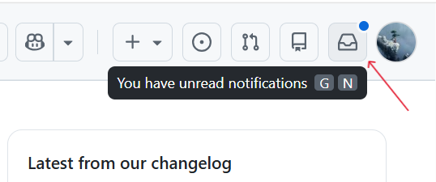
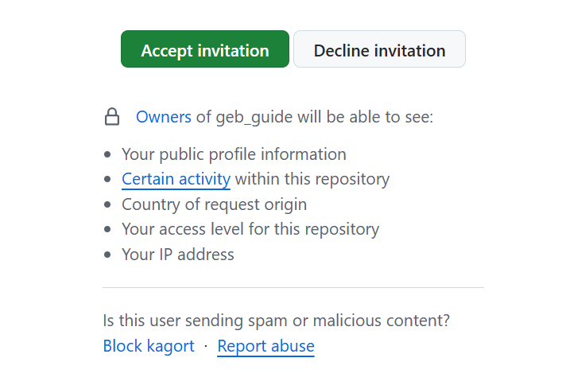
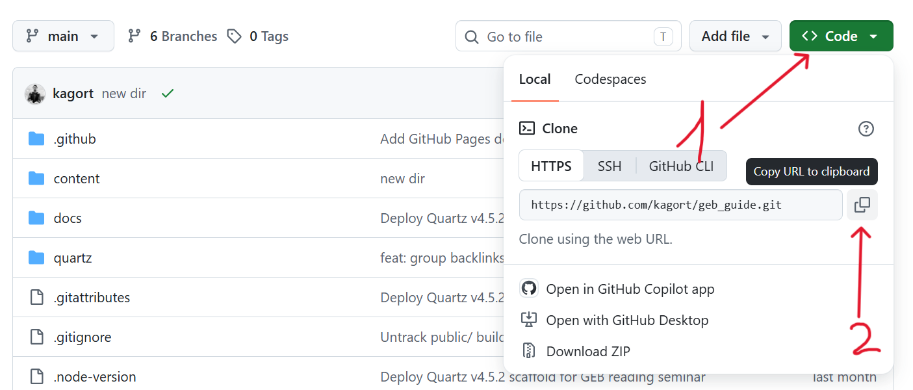

Что нужно от практиканта:
1. Завести учётку на гитхаб
2. Принять приглашение  в сотрудники по проекту
3. Импортируют репозиторий для локальной работы
4. Завести свою ветку от текущего состояния  main
5. В своей ветке внести редактуру в файлы
	1.  Участники  распределяют фотографии https://disk.yandex.ru/d/tREFnAltWgr0ag
	2. Меняют в фотографиях имена файлов на латиницу типа alan-turing.jpg
	3.  Заливают в своих ветках фотографии в папку https://github.com/kagort/geb_guide/tree/main/content/assets/images
	4. Синхронизируют свои локальные проекты с удалённым 
	5. Создают Pull requests с комментариями.


# Инструкция по Git

## Задача 1. Завести учётную запись на GitHub

1. Откройте [github.com](https://github.com)
2. Нажмите **Sign up**
3. Укажите email, пароль, имя пользователя
4. Подтвердите почту по ссылке из письма

> Совет: используйте латиницу или транслит в имени пользователя — так проще работать в команде.

## Задача 2. Принять приглашение в сотрудники по проекту

1. Проверьте почту, на которую пришло приглашение, либо
2. Войдите на GitHub и нажмите на **иконку колокольчика** (уведомления) в правом верхнем углу
3. Найдите приглашение в репозиторий и нажмите **Accept invitation**

После принятия у вас появится доступ к репозиторию.





## Задача 3. Импортировать (склонировать) репозиторий для локальной работы

1. Откройте страницу проекта:
2. Нажмите зелёную кнопку **Code** и скопируйте ссылку (HTTPS)



**Если вы работаете в терминале**

1. Откройте терминал (Windows — Git Bash, Mac — Terminal)

- **WIN + X**  -> терминал
- **WIN** -> пишем **cmd** -> терминал

* **Ctrl + Shift + T** — новая вкладка в Windows Terminal (если он уже открыт)

1. Перейдите в папку, где будет храниться проект (лучше сменить диск):
   * cd D:/название_существующей_папки
     * Папку можно создать заранее
2. 

* git clone <то что вы скопировали>
* cd - это команда перехода внутрь папки внутри терминала

```bash
git clone https://github.com/kagort/geb_guide.git
cd geb_guide
```

Теперь у вас есть локальная копия проекта.

## Задача 4. Завести свою ветку от текущего состояния main

Сначала подтяните актуальное состояние ветки `main`:

```bash
git checkout main
git pull origin main
```

Затем создайте свою ветку и переключитесь на неё (имя ветки — латиницей, например `ivan-ivanov`):

```bash
git checkout -b ivan-ivanov
```

Команда `git checkout -b` сразу создаёт ветку и переключает вас на неё.

**Команды со звездочкой**

```bash
git branch             #  покажет в какой вы ветке, для проверки
git branch -a          # покажет какие ветки существуют помимо вашей
```

P.s. терминал пока не закрываем, он нам еще понадобится, чтобы потом отправить изменения  :)

## Задача 5. Внести правки в файлы в своей ветке

### 5.1. Распределить фотографии

Скачайте свои фотографии по ссылке:
`https://disk.yandex.ru/d/tREFnAltWgr0ag`

### 5.2. Переименовать файлы фотографий латиницей

Приведите имена файлов к виду `alan-turing.jpg`:

- только строчные латинские буквы
- слова разделяются дефисом
- расширение `.jpg` сохраняется
- 
- добавьте фотографии в нужную папку (docs/images)

* Находим скачанную папку проекта на компьютере (можно открыть ее в Obsidian / Vscode / или просто как обычную папку)

### 5.3. Залить фотографии в нужную папку


```bash
git status                                        # проверить, что файлы видны
git add .
git commit -m "Добавлены фотографии: ivan-ivanov"
```

### 5.4. Синхронизировать локальный проект с удалённым

Отправьте свою ветку на GitHub:

```bash
git push -u origin ivan-ivanov
```

Параметр `-u` связывает локальную ветку с удалённой, дальше достаточно будет просто `git push`.

Если нужно подтянуть свежие изменения из `main` в свою ветку:

```bash
git checkout main            #переходит в ветку
git pull origin main         # забираем обновления
git checkout ivan-ivanov     # переходим в свою ветку 
git merge main               # забираем обновления в свою ветку
```

P.s. если вы делаете merge у вас появится экран с большим количеством текста (например)

```bash
Merge branch 'main' into litvel
# Please enter a commit message to explain why this merge is necessary,
# especially if it merges an updated upstream into a topic branch.
#
# Lines starting with '#' will be ignored, and an empty message aborts
# the commit.
~
~
~
~
~
~
~

```

Не пугаемся. Это просто оповещание.
Если это редактр VIM попробуйте:
- Нажмите Esc — выйти из режима ввода
- Наберите :wq и нажмите Enter — сохранить и выйти

Если не сработало, возможно редактор — Nano
- Нажмите Ctrl + O, затем Enter — сохранить
- Нажмите Ctrl + X — выйти


### 5.5. Создать Pull Request с комментарием

1. Откройте страницу репозитория на GitHub
2. Сверху появится кнопка **Compare & pull request** — нажмите её
   - Если кнопки нет: перейдите во вкладку **Pull requests** → **New pull request**
3. Убедитесь, что:
   - **base:** `main`
   - **compare:** ваша ветка (`ivan-ivanov`)
4. Введите заголовок, например: `Фотографии: ivan-ivanov`
5. В поле комментария опишите, что сделано:
   - какие фотографии добавлены
   - какие имена файлов изменены
   - что ещё правили в файлах
6. Нажмите **Create pull request**

После этого остаётся дождаться проверки и ответить на замечания, если они появятся.

---


## Краткая шпаргалка команд

```bash
git clone <ссылка>            # склонировать репозиторий
git checkout main             # перейти в main
git pull origin main          # обновить main
git checkout -b имя-ветки     # создать свою ветку
git status                    # посмотреть изменения
git add <файлы>               # добавить файлы в коммит
git add .                     # сохранить все изменения
git commit -m "сообщение"     # сделать коммит
git push -u origin имя-ветки  # отправить ветку на GitHub
git push                      # если предыдущую команду уже хоть 1 раз использовали
```
